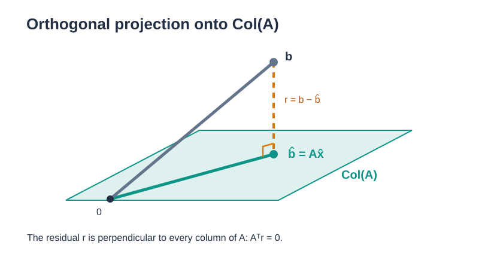

# 3. Linear Algebra — Systems, Rank and Projections

## Key Takeaways

- Solving **$Ax=b$** means expressing $b$ as a linear combination of the columns of $A$.
- The **rank** counts independent column directions; the **null space** contains inputs that map to zero.
- The **rank-nullity theorem** explains when solutions are unique or non-unique.
- When an exact solution does not exist, **orthogonal projection** provides the closest representable output.
- **Least squares** minimizes squared residuals and leads to the normal equations.
- Linear regression is geometrically a projection of the target vector onto the column space of the design matrix.

---

## 1. Systems of Linear Equations

**Context:** A linear system represents several constraints on the same unknown variables. Expressing the equations as $Ax=b$ makes it possible to study existence and uniqueness using matrix geometry.

**Example:** The system $2x_1+x_2=5$ and $x_1+3x_2=7$ has the matrix form

```math
\begin{bmatrix}2&1\\1&3\end{bmatrix}
\begin{bmatrix}x_1\\x_2\end{bmatrix}
=
\begin{bmatrix}5\\7\end{bmatrix}
```

Its unique solution is $x_1=8/5$ and $x_2=9/5$. Geometrically, the two equations describe lines meeting at that point.

A linear system can be written as:

```math
Ax=b,
\qquad
A\in\mathbb{R}^{m\times n},
\quad x\in\mathbb{R}^n,
\quad b\in\mathbb{R}^m
```

The columns $a_i$ of $A$ generate the possible outputs:

```math
Ax=x_1a_1+\cdots+x_na_n
```

The **column space** is the span of those columns:

```math
\mathrm{Col}(A)=\mathrm{span}(a_1,\ldots,a_n)
```

Consequently, the system is solvable exactly if and only if:

```math
Ax=b \text{ has a solution }
\iff b\in\mathrm{Col}(A)
```

A system can have a unique solution, infinitely many solutions, or no solution.

<p align="center">
  
</p>

**Illustration:** A target vector outside the column space cannot be reproduced exactly by a linear model.

---

## 2. Matrix Rank

**Context:** Rank measures the number of independent directions that a matrix transformation can produce. Having many columns does not necessarily imply having many distinct directions.

**Example:** In the matrix below, $a_2=2a_1$. Every output can be written as $(x_1+2x_2)a_1$, meaning the column space is only one-dimensional, even though the matrix has two columns.

The **rank** is the number of linearly independent columns (also equal to the number of independent rows):

```math
\mathrm{rank}(A)=\dim(\mathrm{Col}(A))
\leq\min(m,n)
```

For example:

```math
A=
\begin{bmatrix}
1&2\\
2&4\\
3&6
\end{bmatrix},
\qquad
\mathrm{rank}(A)=1
```

The second column is twice the first, so it adds no independent direction.

**Full column rank** means $\mathrm{rank}(A)=n$; for a square matrix, full rank also means the matrix is invertible.

**Illustration:** If features in a design matrix are exact linear combinations of others, the matrix is rank-deficient, causing perfect multicollinearity.

---

## 3. Column Space and Null Space

**Context:** These two spaces describe different aspects of a transformation: the column space consists of reachable **outputs** in $\mathbb{R}^m$, while the null space consists of **inputs** in $\mathbb{R}^n$ that are sent to zero.

### 3.1 Computing the Null Space

Consider:

```math
A=
\begin{bmatrix}
1&2\\
2&4
\end{bmatrix},
\qquad
x=
\begin{bmatrix}
x_1\\x_2
\end{bmatrix}
```

We want all vectors $x$ satisfying $Ax=0$. Expanding the matrix multiplication:

```math
\begin{bmatrix}
1&2\\
2&4
\end{bmatrix}
\begin{bmatrix}
x_1\\x_2
\end{bmatrix}
=
\begin{bmatrix}
x_1+2x_2\\
2x_1+4x_2
\end{bmatrix}
=
\begin{bmatrix}
0\\0
\end{bmatrix}
```

This produces the system:

```math
\begin{cases}
x_1+2x_2=0\\
2x_1+4x_2=0
\end{cases}
```

The second equation is twice the first, so only one independent constraint remains:

```math
x_1=-2x_2
```

Let $x_2=t$, where $t\in\mathbb{R}$. Then $x_1=-2t$, and every solution is:

```math
x=
\begin{bmatrix}
-2t\\t
\end{bmatrix}
=
t\begin{bmatrix}
-2\\1
\end{bmatrix}
```

Therefore:

```math
\boxed{
\mathrm{Null}(A)=
\left\{t\begin{bmatrix}-2\\1\end{bmatrix}:t\in\mathbb{R}\right\}
=
\mathrm{span}\left(
\begin{bmatrix}-2\\1\end{bmatrix}
\right)
}
```

The null space is **non-trivial** because it contains nonzero vectors; the vector $(-2,1)^\top$ is a direction that the transformation sends to zero.

### 3.2 Computing the Column Space

For the same matrix, its columns are:

```math
a_1=\begin{bmatrix}1\\2\end{bmatrix},
\qquad
a_2=\begin{bmatrix}2\\4\end{bmatrix}
=2a_1
```

Every output can therefore be expanded as:

```math
Ax
=
x_1\begin{bmatrix}1\\2\end{bmatrix}
+
x_2\begin{bmatrix}2\\4\end{bmatrix}
=
(x_1+2x_2)\begin{bmatrix}1\\2\end{bmatrix}
```

Since $x_1+2x_2$ can be any real number $s$, the set of possible outputs is:

```math
\boxed{
\mathrm{Col}(A)
=
\left\{s\begin{bmatrix}1\\2\end{bmatrix}:s\in\mathbb{R}\right\}
=
\mathrm{span}\left(
\begin{bmatrix}1\\2\end{bmatrix}
\right)
}
```

Hence both spaces are one-dimensional, but they answer different questions: the **column space** describes outputs that can be produced, while the **null space** describes inputs that produce zero.

### 3.3 ML Interpretation: Different Weights, Same Predictions

Suppose a feature matrix $X$ and two parameter vectors $w_1,w_2$ produce identical predictions:

```math
Xw_1=Xw_2
```

Subtracting both sides gives:

```math
Xw_1-Xw_2=0
\quad\Longrightarrow\quad
X(w_1-w_2)=0
```

By definition of the null space:

```math
\boxed{w_1-w_2\in\mathrm{Null}(X)}
```

For a concrete example, reuse:

```math
X=
\begin{bmatrix}
1&2\\
2&4
\end{bmatrix},
\qquad
w_1=\begin{bmatrix}3\\1\end{bmatrix},
\qquad
w_2=\begin{bmatrix}1\\2\end{bmatrix}
```

Compute both prediction vectors:

```math
Xw_1=
\begin{bmatrix}
1(3)+2(1)\\
2(3)+4(1)
\end{bmatrix}
=
\begin{bmatrix}5\\10\end{bmatrix}
```

```math
Xw_2=
\begin{bmatrix}
1(1)+2(2)\\
2(1)+4(2)
\end{bmatrix}
=
\begin{bmatrix}5\\10\end{bmatrix}
```

Their difference is:

```math
w_1-w_2=
\begin{bmatrix}2\\-1\end{bmatrix}
=-\begin{bmatrix}-2\\1\end{bmatrix}
\in\mathrm{Null}(X)
```

And multiplying confirms it:

```math
X(w_1-w_2)=
\begin{bmatrix}1&2\\2&4\end{bmatrix}
\begin{bmatrix}2\\-1\end{bmatrix}
=
\begin{bmatrix}0\\0\end{bmatrix}
```

**Illustration:** Different parameter vectors may produce exactly the same predictions when the design matrix has a non-trivial null space. In this case the coefficients are not uniquely identifiable from the predictions alone.

---

## 4. Rank-Nullity and Solution Uniqueness

**Context:** Rank-nullity tells us how many independent input directions affect the output (the rank) and how many produce no change in the output (the nullity). If the nullity is greater than zero, we can change a solution along those null-space directions without changing $Ax$, so a consistent system has multiple solutions.

### Worked Example: Infinitely Many Solutions

Consider a consistent system with three equations and two unknowns:

```math
A=
\begin{bmatrix}
1&2\\
2&4\\
3&6
\end{bmatrix},
\qquad
b=
\begin{bmatrix}
1\\2\\3
\end{bmatrix}
```

The second column is twice the first, so $\mathrm{rank}(A)=1$. As there are two input variables, rank-nullity gives:

```math
\dim(\mathrm{Null}(A))=2-1=1
```

A particular solution is $x_p=(1,0)^\top$, since $Ax_p=b$. A null-space direction is $v=(-2,1)^\top$, since $Av=0$.

Consequently, **every solution** is:

```math
x=x_p+tv
=
\begin{bmatrix}
1-2t\\t
\end{bmatrix},
\qquad t\in\mathbb{R}
```

To verify this, substitute into the first equation:

```math
x_1+2x_2=(1-2t)+2t=1
```

The other equations are multiples of the first, so they are also satisfied. For example, $t=0$ gives $(1,0)^\top$, while $t=1$ gives $(-1,1)^\top$; both produce the same output $b$.

**Interpretation:** The rank counts one direction that changes the output, while the one-dimensional null space represents a free parameter direction that leaves the output unchanged.

For $A\in\mathbb{R}^{m\times n}$:

```math
\boxed{\mathrm{rank}(A)+\dim(\mathrm{Null}(A))=n}
```

The null space determines whether a solution of $Ax=b$ is unique. If $x_p$ is one particular solution, every solution is of the form:

```math
x=x_p+v,
\qquad v\in\mathrm{Null}(A)
```

Indeed, since $Av=0$:

```math
A(x_p+v)=Ax_p+Av=b+0=b
```

Conversely, any two solutions $x_1,x_2$ satisfy $A(x_1-x_2)=0$, so their difference belongs to $\mathrm{Null}(A)$.

Therefore, **provided the system has at least one solution**, a trivial null space gives a unique solution, while a non-trivial null space gives infinitely many solutions.

- **Overdetermined:** $m>n$ (more equations than unknowns); an exact solution may not exist.
- **Underdetermined:** $m<n$ (more unknowns than equations); any consistent system has infinitely many solutions.

**Illustration:** In high-dimensional regression with more features than observations, unregularized parameters cannot be uniquely identified from the training predictions alone.

---

## 5. Orthogonal Projections

**Context:** Exact reconstruction is not always possible. When a target lies outside the column space, we instead look for the reachable point with the smallest Euclidean distance to it. The shortest residual is perpendicular to the subspace.

### Worked Example: Projection Onto a Line

```math
A=\begin{bmatrix}1\\1\end{bmatrix},
\qquad
b=\begin{bmatrix}3\\1\end{bmatrix}
```

```math
Ax=\begin{bmatrix}x\\x\end{bmatrix},
\qquad
J(x)=\|Ax-b\|_2^2=(x-3)^2+(x-1)^2
```

```math
J'(x)=2(x-3)+2(x-1)=4x-8=0
\quad\Longrightarrow\quad
\hat x=2
```

```math
\hat b=A\hat x=\begin{bmatrix}2\\2\end{bmatrix},
\qquad
r=b-\hat b=\begin{bmatrix}1\\-1\end{bmatrix}
```

```math
A^\top r=
\begin{bmatrix}1&1\end{bmatrix}
\begin{bmatrix}1\\-1\end{bmatrix}
=0
```


If $b\notin\mathrm{Col}(A)$, there is no exact solution to $Ax=b$. Instead, we find the closest vector in the column space:

```math
\hat b=A\hat x,
\qquad
\hat x=\arg\min_x\|Ax-b\|_2^2
```

The residual is:

```math
r=b-\hat b
```

At the orthogonal projection, it is perpendicular to the entire column space:

```math
r\perp\mathrm{Col}(A)
\qquad\Longleftrightarrow\qquad
A^\top r=0
```

<p align="center">
  
</p>

**Illustration:** A regression model chooses the closest prediction vector to the targets among all predictions representable by its feature columns.

---

## 6. Least Squares and Normal Equations

**Context:** Least squares translates the geometric projection problem into minimization of squared residuals. Setting the gradient of this quadratic objective to zero yields the normal equations, which are exactly the perpendicular-residual condition.

**Example:** To fit one constant value to observations $b=(1,2,4)^\top$, choose $A=(1,1,1)^\top$. Then

```math
A^\top A\hat x=A^\top b
\quad\Longrightarrow\quad
3\hat x=7
\quad\Longrightarrow\quad
\hat x=\frac73
```

Thus least squares returns the mean of the three observations, and the residuals sum to zero.

The **least-squares objective** is:

```math
J(x)=\|Ax-b\|_2^2
=(Ax-b)^\top(Ax-b)
```

Expanding and differentiating:

```math
J(x)=x^\top A^\top Ax-2b^\top Ax+b^\top b
```

```math
\nabla_xJ(x)=2A^\top Ax-2A^\top b
```

Setting the gradient to zero yields the **normal equations**:

```math
\boxed{A^\top A\hat x=A^\top b}
```

If $A$ has full column rank, the solution is unique:

```math
\boxed{\hat x=(A^\top A)^{-1}A^\top b}
```

For rank-deficient matrices, minimizers still exist but may not be unique. In practice, numerical solvers using **QR decomposition or SVD** are preferred over forming the inverse explicitly.

**Illustration:** The normal equations are the algebraic form of the geometric condition $A^\top r=0$.

---

## 7. Connection to Linear Regression

**Context:** A linear regression model cannot predict every arbitrary vector: all its fitted values lie in the column space of $X$. Training finds the closest point in that space to the target vector $y$.

**Example:** With an intercept-only model, $X=(1,1,1)^\top$ and $y=(1,2,4)^\top$, all predictions must be constant. Least squares chooses $\hat y=(7/3,7/3,7/3)^\top$. If two feature columns are identical, the fitted predictions are still unique, but their individual coefficients need not be.

For a dataset $X\in\mathbb{R}^{N\times d}$ and targets $y\in\mathbb{R}^N$, ordinary least squares solves:

```math
w^*=\arg\min_w\|Xw-y\|_2^2
```

The fitted predictions $\hat y=Xw^*$ are the **orthogonal projection** of $y$ onto $\mathrm{Col}(X)$:

```math
X^\top(y-Xw^*)=0
```

If the columns of $X$ are linearly dependent, the coefficient vector may not be unique even though the fitted prediction vector is unique.

**Illustration:** L2 regularization can make the coefficient estimate unique even when features are redundant, while also discouraging large weights.

---

## 8. Conceptual Hierarchy

**Context:** The main progression is from **exact solvability** to **best approximation**. Rank and the null space describe the available directions and solution uniqueness; projection and least squares handle inconsistent systems.

**Example:** For a target vector outside $\mathrm{Col}(A)$, no exact coefficient vector exists. The normal equations instead identify a coefficient vector whose predictions equal the orthogonal projection of the target.

```text
Linear system: Ax = b
        ↓
Is b in the column space?
    ├── Yes → exact solution(s)
    └── No  → closest approximation
                  ↓
         Orthogonal projection
                  ↓
        Least-squares objective
                  ↓
           Normal equations
                  ↓
           Linear regression
```

The central connection is:

```math
b\notin\mathrm{Col}(A)
\quad\Longrightarrow\quad
\min_x\|Ax-b\|_2^2
\quad\Longrightarrow\quad
A^\top A\hat x=A^\top b
```
