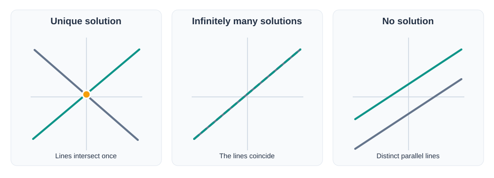
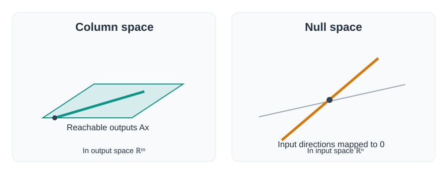

# 3. Linear Algebra — Systems, Rank and Projections

## Key Takeaways

- Solving **$Ax=b$** means expressing $b$ as a linear combination of the columns of $A$.
- The **rank** counts independent column directions; the **null space** contains inputs that map to zero.
- The **rank-nullity theorem** explains when solutions are unique or non-unique.
- When an exact solution does not exist, **orthogonal projection** provides the closest representable output.
- **Least squares** minimizes squared residuals and leads to the normal equations.
- Linear regression is geometrically a projection of the target vector onto the column space of the design matrix.

---

## 1. Systems of Linear Equations

**Context:** A linear system represents several constraints on the same unknown variables. Expressing the equations as $Ax=b$ makes it possible to study existence and uniqueness using matrix geometry.

**Example:** The system $2x_1+x_2=5$ and $x_1+3x_2=7$ has the matrix form

```math
\begin{bmatrix}2&1\\1&3\end{bmatrix}
\begin{bmatrix}x_1\\x_2\end{bmatrix}
=
\begin{bmatrix}5\\7\end{bmatrix}
```

Its unique solution is $x_1=8/5$ and $x_2=9/5$. Geometrically, the two equations describe lines meeting at that point.

A linear system can be written as:

```math
Ax=b,
\qquad
A\in\mathbb{R}^{m\times n},
\quad x\in\mathbb{R}^n,
\quad b\in\mathbb{R}^m
```

The columns $a_i$ of $A$ generate the possible outputs:

```math
Ax=x_1a_1+\cdots+x_na_n
```

The **column space** is the span of those columns:

```math
\mathrm{Col}(A)=\mathrm{span}(a_1,\ldots,a_n)
```

Consequently, the system is solvable exactly if and only if:

```math
Ax=b \text{ has a solution }
\iff b\in\mathrm{Col}(A)
```

A system can have a unique solution, infinitely many solutions, or no solution.

<p align="center">
  
</p>

**Illustration:** A target vector outside the column space cannot be reproduced exactly by a linear model.

---

## 2. Matrix Rank

**Context:** Rank measures the number of independent directions that a matrix transformation can produce. Having many columns does not necessarily imply having many distinct directions.

**Example:** In the matrix below, $a_2=2a_1$. Every output can be written as $(x_1+2x_2)a_1$, meaning the column space is only one-dimensional, even though the matrix has two columns.

The **rank** is the number of linearly independent columns (also equal to the number of independent rows):

```math
\mathrm{rank}(A)=\dim(\mathrm{Col}(A))
\leq\min(m,n)
```

For example:

```math
A=
\begin{bmatrix}
1&2\\
2&4\\
3&6
\end{bmatrix},
\qquad
\mathrm{rank}(A)=1
```

The second column is twice the first, so it adds no independent direction.

**Full column rank** means $\mathrm{rank}(A)=n$; for a square matrix, full rank also means the matrix is invertible.

**Illustration:** If features in a design matrix are exact linear combinations of others, the matrix is rank-deficient, causing perfect multicollinearity.

---

## 3. Column Space and Null Space

**Context:** These two spaces describe different aspects of a transformation: the column space consists of reachable **outputs** in $\mathbb{R}^m$, while the null space consists of **inputs** in $\mathbb{R}^n$ that are sent to zero.

**Example:** For the matrix below, $Ax=0$ reduces to $x_1+2x_2=0$. Every solution is $x=t(-2,1)^\top$. Meanwhile, the output $Ax=(x_1+2x_2)(1,2)^\top$ always lies on the line spanned by $(1,2)^\top$.

The column space describes possible **outputs**:

```math
\mathrm{Col}(A)=\{Ax:x\in\mathbb{R}^{n}\}
```

The **null space** describes input directions that disappear under the transformation:

```math
\mathrm{Null}(A)=\{x\in\mathbb{R}^n:Ax=0\}
```

For example:

```math
A=
\begin{bmatrix}
1&2\\
2&4
\end{bmatrix}
\quad\Longrightarrow\quad
\mathrm{Null}(A)=
\mathrm{span}
\left(
\begin{bmatrix}-2\\1\end{bmatrix}
\right)
```

<p align="center">
  
</p>

**Illustration:** If $Xw_1=Xw_2$, then $w_1-w_2\in\mathrm{Null}(X)$: two coefficient vectors produce the same predictions.

---

## 4. Rank-Nullity and Solution Uniqueness

**Context:** Rank-nullity divides input dimensions into independent directions preserved by a transformation and directions lost to its null space. This explains why some systems have multiple parameter solutions.

**Example:** A $3\times2$ matrix with rank $1$ has nullity $2-1=1$. If it is consistent, any solution can be shifted along one independent null-space direction without changing the output. In an underdetermined system ($m<n$), the null space is necessarily nontrivial.

For $A\in\mathbb{R}^{m\times n}$:

```math
\boxed{\mathrm{rank}(A)+\dim(\mathrm{Null}(A))=n}
```

If $x_0$ solves $Ax=b$, all solutions have the form:

```math
x=x_0+z,
\qquad z\in\mathrm{Null}(A)
```

Therefore, a **trivial null space** implies at most one solution, while a nontrivial null space gives infinitely many solutions whenever the system is consistent.

- **Overdetermined:** $m>n$ (more equations than unknowns); an exact solution may not exist.
- **Underdetermined:** $m<n$ (more unknowns than equations); any consistent system has infinitely many solutions.

**Illustration:** In high-dimensional regression with more features than observations, unregularized parameters cannot be uniquely identified from the training predictions alone.

---

## 5. Orthogonal Projections

**Context:** Exact reconstruction is not always possible. When a target lies outside the column space, we instead look for the reachable point with the smallest Euclidean distance to it. The shortest residual is perpendicular to the subspace.

**Example:** Project $b=(3,2)^\top$ onto the horizontal axis, represented by $A=(1,0)^\top$. The closest output is $\hat b=(3,0)^\top$ and the residual is $r=(0,2)^\top$. It is perpendicular to the column: $A^\top r=0$.

If $b\notin\mathrm{Col}(A)$, there is no exact solution to $Ax=b$. Instead, we find the closest vector in the column space:

```math
\hat b=A\hat x,
\qquad
\hat x=\arg\min_x\|Ax-b\|_2^2
```

The residual is:

```math
r=b-\hat b
```

At the orthogonal projection, it is perpendicular to the entire column space:

```math
r\perp\mathrm{Col}(A)
\qquad\Longleftrightarrow\qquad
A^\top r=0
```

<p align="center">
  
</p>

**Illustration:** A regression model chooses the closest prediction vector to the targets among all predictions representable by its feature columns.

---

## 6. Least Squares and Normal Equations

**Context:** Least squares translates the geometric projection problem into minimization of squared residuals. Setting the gradient of this quadratic objective to zero yields the normal equations, which are exactly the perpendicular-residual condition.

**Example:** To fit one constant value to observations $b=(1,2,4)^\top$, choose $A=(1,1,1)^\top$. Then

```math
A^\top A\hat x=A^\top b
\quad\Longrightarrow\quad
3\hat x=7
\quad\Longrightarrow\quad
\hat x=\frac73
```

Thus least squares returns the mean of the three observations, and the residuals sum to zero.

The **least-squares objective** is:

```math
J(x)=\|Ax-b\|_2^2
=(Ax-b)^\top(Ax-b)
```

Expanding and differentiating:

```math
J(x)=x^\top A^\top Ax-2b^\top Ax+b^\top b
```

```math
\nabla_xJ(x)=2A^\top Ax-2A^\top b
```

Setting the gradient to zero yields the **normal equations**:

```math
\boxed{A^\top A\hat x=A^\top b}
```

If $A$ has full column rank, the solution is unique:

```math
\boxed{\hat x=(A^\top A)^{-1}A^\top b}
```

For rank-deficient matrices, minimizers still exist but may not be unique. In practice, numerical solvers using **QR decomposition or SVD** are preferred over forming the inverse explicitly.

**Illustration:** The normal equations are the algebraic form of the geometric condition $A^\top r=0$.

---

## 7. Connection to Linear Regression

**Context:** A linear regression model cannot predict every arbitrary vector: all its fitted values lie in the column space of $X$. Training finds the closest point in that space to the target vector $y$.

**Example:** With an intercept-only model, $X=(1,1,1)^\top$ and $y=(1,2,4)^\top$, all predictions must be constant. Least squares chooses $\hat y=(7/3,7/3,7/3)^\top$. If two feature columns are identical, the fitted predictions are still unique, but their individual coefficients need not be.

For a dataset $X\in\mathbb{R}^{N\times d}$ and targets $y\in\mathbb{R}^N$, ordinary least squares solves:

```math
w^*=\arg\min_w\|Xw-y\|_2^2
```

The fitted predictions $\hat y=Xw^*$ are the **orthogonal projection** of $y$ onto $\mathrm{Col}(X)$:

```math
X^\top(y-Xw^*)=0
```

If the columns of $X$ are linearly dependent, the coefficient vector may not be unique even though the fitted prediction vector is unique.

**Illustration:** L2 regularization can make the coefficient estimate unique even when features are redundant, while also discouraging large weights.

---

## 8. Conceptual Hierarchy

**Context:** The main progression is from **exact solvability** to **best approximation**. Rank and the null space describe the available directions and solution uniqueness; projection and least squares handle inconsistent systems.

**Example:** For a target vector outside $\mathrm{Col}(A)$, no exact coefficient vector exists. The normal equations instead identify a coefficient vector whose predictions equal the orthogonal projection of the target.

```text
Linear system: Ax = b
        ↓
Is b in the column space?
    ├── Yes → exact solution(s)
    └── No  → closest approximation
                  ↓
         Orthogonal projection
                  ↓
        Least-squares objective
                  ↓
           Normal equations
                  ↓
           Linear regression
```

The central connection is:

```math
b\notin\mathrm{Col}(A)
\quad\Longrightarrow\quad
\min_x\|Ax-b\|_2^2
\quad\Longrightarrow\quad
A^\top A\hat x=A^\top b
```
