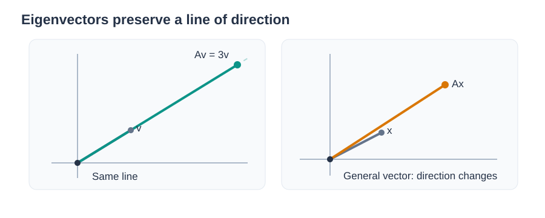
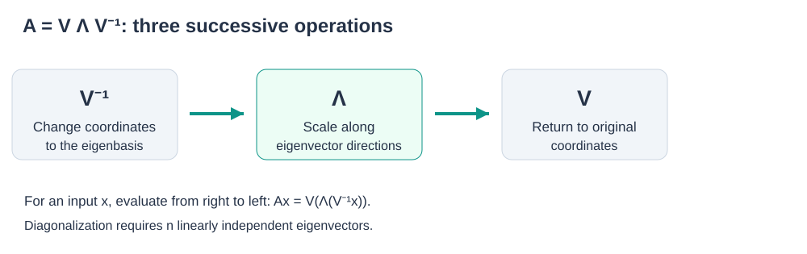

# 4. Linear Algebra — Eigenvalues, Eigenvectors and Eigendecomposition

## Key Takeaways

- An **eigenvector** is a nonzero vector whose line of direction is preserved by a square-matrix transformation: $Av=\lambda v$.
- The **eigenvalue** $\lambda$ describes stretching, shrinking, reversal or collapse along that direction.
- The **determinant** measures signed area/volume scaling for square matrices; determinant zero means the transformation collapses dimension.
- A **singular matrix** is a square matrix without an inverse, equivalently one with a nontrivial null space.
- Eigenvalues solve $\det(A-\lambda I)=0$; eigenvectors are nonzero solutions of $(A-\lambda I)v=0$.
- When sufficiently many independent eigenvectors exist, **eigendecomposition** expresses a transformation as scaling in a different basis.
- Real symmetric matrices admit orthogonal eigendecomposition, a property used by covariance matrices and PCA.

---

## 1. Eigenvectors and Eigenvalues

For a square matrix $A\in\mathbb{R}^{n\times n}$, a **nonzero** vector $v$ is an eigenvector if:

```math
Av=\lambda v
```

where $\lambda$ is the corresponding **eigenvalue**.

Geometrically, $A$ maps an eigenvector onto the same line through the origin:

- $\lambda>1$: stretch; $0<\lambda<1$: shrink.
- $\lambda=1$: unchanged; $\lambda=0$: collapsed to zero.
- $\lambda<0$: reverse direction and scale by $|\lambda|$.

**Example:**

```math
A=\begin{bmatrix}3&0\\0&2\end{bmatrix},
\quad
Ae_1=3e_1,
\quad
Ae_2=2e_2
```

The coordinate axes are eigenvector directions, associated with eigenvalues $3$ and $2$.

<p align="center">
  
</p>

---

## 2. Determinants, Singularity and the Characteristic Equation

The **determinant** is a scalar associated with a square matrix that measures the **signed factor by which the transformation scales area (in 2D) or volume (in higher dimensions)**.

For a $2\times2$ matrix:

```math
A=\begin{bmatrix}a&b\\c&d\end{bmatrix},
\qquad
\det(A)=ad-bc
```

- $|\det(A)|$ gives the area/volume scaling factor.
- The sign describes whether orientation is preserved or reversed.
- $\det(A)=0$ means some dimension is collapsed: the transformation cannot be reversed.

A **singular matrix** is a square matrix that has **no inverse**. The following conditions are equivalent for a square matrix $A$:

```math
\det(A)=0
\iff A\text{ is singular}
\iff \mathrm{rank}(A)<n
\iff \mathrm{Null}(A)\neq\{0\}
```

**Example:**

```math
A=\begin{bmatrix}1&2\\2&4\end{bmatrix},
\qquad
\det(A)=4-4=0
```

Indeed, $A(2,-1)^\top=0$: a nonzero input is collapsed to zero.

To compute eigenvalues, rearrange $Av=\lambda v$:

```math
(A-\lambda I)v=0
```

Because $v\neq0$, the matrix $A-\lambda I$ must be **singular**. Therefore:

```math
\boxed{\det(A-\lambda I)=0}
```

This is the **characteristic equation**.

**Important:** A real matrix can have complex eigenvalues; a rotation by $90^\circ$ in the plane has no real eigenvector.

---

## 3. Computing Eigenvalues and Eigenvectors

Consider:

```math
A=\begin{bmatrix}3&1\\0&2\end{bmatrix}
```

Its characteristic equation is:

```math
\det(A-\lambda I)
=
\begin{vmatrix}
3-\lambda&1\\
0&2-\lambda
\end{vmatrix}
=(3-\lambda)(2-\lambda)=0
```

Thus:

```math
\lambda_1=3,
\qquad
\lambda_2=2
```

### Eigenvector for $\lambda_1=3$

We solve:

```math
(A-3I)v=
\begin{bmatrix}0&1\\0&-1\end{bmatrix}
\begin{bmatrix}v_1\\v_2\end{bmatrix}
=
\begin{bmatrix}v_2\\-v_2\end{bmatrix}
=0
```

The only restriction is $v_2=0$. **There is no equation restricting $v_1$**, so it is a *free variable*:

```math
v=\begin{bmatrix}t\\0\end{bmatrix},
\qquad t\neq0
```

We choose $t=1$ because eigenvectors are defined only up to nonzero scaling:

```math
\boxed{v^{(1)}=\begin{bmatrix}1\\0\end{bmatrix}}
```

Vectors such as $(2,0)^\top$ and $(-5,0)^\top$ are also valid eigenvectors for the same eigenvalue; they lie on the same line.

### Eigenvector for $\lambda_2=2$

Similarly:

```math
(A-2I)v=
\begin{bmatrix}1&1\\0&0\end{bmatrix}v=0
```

This gives $v_1+v_2=0$, so one choice is:

```math
\boxed{v^{(2)}=\begin{bmatrix}1\\-1\end{bmatrix}}
```

**Illustration:** Computing eigenvectors is a null-space problem, exactly as studied in Chapter 3.

---

## 4. Eigenspaces and Multiplicity

For an eigenvalue $\lambda$, its **eigenspace** is:

```math
E_\lambda=\mathrm{Null}(A-\lambda I)
```

It contains all eigenvectors for $\lambda$ **and the zero vector**; only its nonzero members are eigenvectors.

Two multiplicities are useful:

- **Algebraic multiplicity:** the number of times $\lambda$ occurs as a root of the characteristic polynomial.
- **Geometric multiplicity:** $\dim(E_\lambda)$, the number of independent eigenvector directions associated with $\lambda$.

For example, $A=\mathrm{diag}(2,2,5)$ has a two-dimensional eigenspace for $\lambda=2$.

Geometric multiplicity never exceeds algebraic multiplicity. A matrix is diagonalizable precisely when it has enough independent eigenvectors to form a basis.

---

## 5. Eigendecomposition and Diagonalization

Suppose $A$ has $n$ linearly independent eigenvectors, assembled as columns of:

```math
V=[v_1\ \cdots\ v_n],
\qquad
\Lambda=\mathrm{diag}(\lambda_1,\ldots,\lambda_n)
```

Then $AV=V\Lambda$, and because $V$ is invertible:

```math
\boxed{A=V\Lambda V^{-1}}
```

Geometrically, the transformation consists of three steps:

1. $V^{-1}$ expresses the input in the **eigenvector basis**.
2. $\Lambda$ scales the independent eigenvector coordinates.
3. $V$ converts back to the original coordinates.

<p align="center">
  
</p>

A useful consequence for repeated transformations is:

```math
A^k=V\Lambda^kV^{-1}
```

Since $\Lambda$ is diagonal, computing $\Lambda^k$ only requires raising each eigenvalue to the power $k$.

**Important:** Not every square matrix is diagonalizable.

---

## 6. Symmetric and Positive Semidefinite Matrices

For a **real symmetric matrix**, $A=A^\top$, the **spectral theorem** guarantees real eigenvalues and an orthonormal eigenvector basis:

```math
\boxed{A=Q\Lambda Q^\top},
\qquad
Q^\top Q=I
```

The orthogonal eigenvectors make the change of basis particularly convenient.

A real symmetric matrix is **positive semidefinite** (PSD) if:

```math
x^\top Ax\geq0
\qquad\text{for all }x
```

This is equivalent to all its eigenvalues being nonnegative. It is **positive definite** when $x^\top Ax>0$ for every nonzero $x$, equivalently when all eigenvalues are strictly positive.

**Brief ML connection:** A centered dataset's covariance matrix, $\Sigma=\frac{1}{N-1}X^\top X$, is symmetric PSD. PCA uses its eigenvectors as orthogonal directions and its eigenvalues as the variances along those directions.

---

## 7. Conceptual Hierarchy

```text
Matrix transformation: Av
          ↓
Special directions: Av = λv
          ↓
Characteristic equation: det(A − λI) = 0
          ↓
Eigenvectors: Null(A − λI)
          ↓
Independent eigenvector basis?
          ↓
Eigendecomposition: A = VΛV⁻¹
          ↓
Symmetric case: A = QΛQᵀ
```

The key insight is that **eigenvectors reveal directions along which a linear transformation acts as simple scalar multiplication**.
